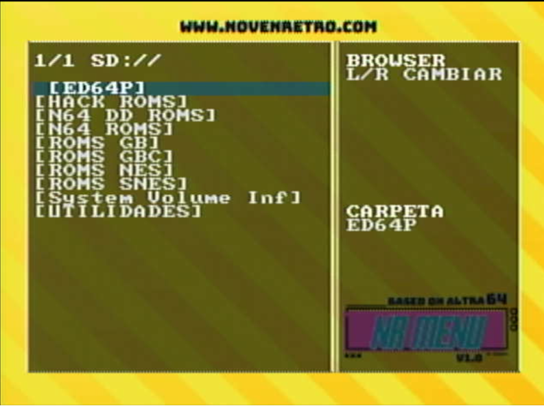
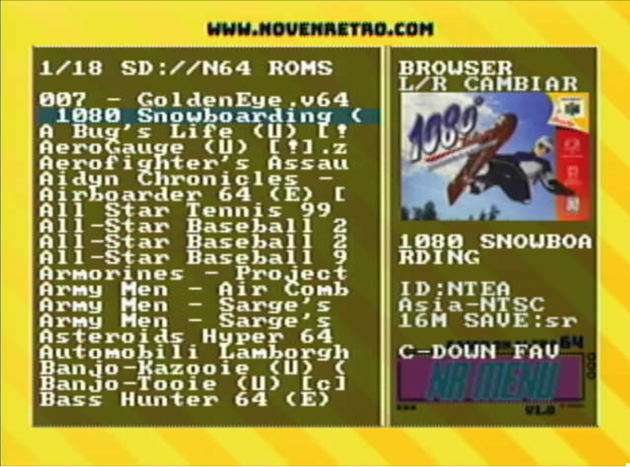
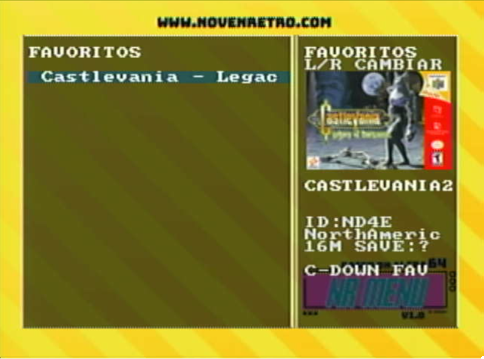
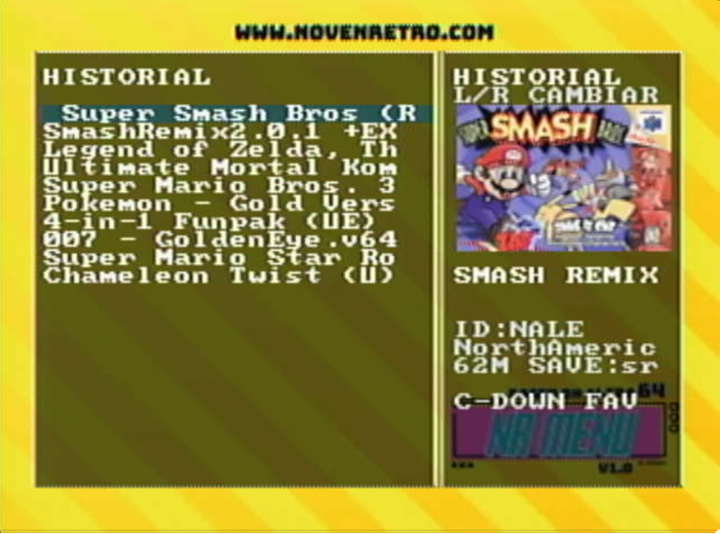

# NRMenu v1.0

[](https://github.com/NovenRetro/NRMenu/actions/workflows/build.yml)
[](https://github.com/NovenRetro/NRMenu/releases/latest)
[](https://github.com/NovenRetro/NRMenu)

Frontend visual para **ED64 Plus**, basado en **ALTRA64**, con navegador de ROMs en dos paneles, carátulas, Favoritos e Historial.

> **NRMenu es gratuito y no se comercializa.** Los paquetes oficiales no incluyen ROMs. Se distribuye con fines educativos y de preservación, sin garantía. Respaldá siempre la tarjeta SD y las partidas antes de instalar o actualizar.

## Estado del proyecto

**Firmware estable:** `NRMenu v1.0`  
**Revisión del repositorio y herramientas:** `1.0.1`  
**Hardware validado:** ED64 Plus con firmware v110  
**Base técnica fijada:** `ariahiro64/altra64@666dee10724dd725183cf2183d67e7632c73b2de`  
**Contenedor fijado:** `ghcr.io/ariahiro64/altra64@sha256:d2f82b3eabd75bae163fae707e701d1c85cd43c1c0a5ec880909495eb5abc14a`

NRMenu v1.0 fue desarrollado procurando conservar el comportamiento de carga, emulación y guardado de la base funcional de ALTRA64. Sus limitaciones heredadas siguen siendo aplicables.

## Descargas e instalación rápida

La página de [Releases](https://github.com/NovenRetro/NRMenu/releases/latest) ofrece dos formas de instalación.

### Instalación completa en una SD nueva

Descargá el paquete indicado como **Ready to Use** en la Release correspondiente.

1. Formateá la tarjeta SD en FAT32.
2. Extraé el contenido del ZIP en la raíz de la SD.
3. Agregá tus ROMs obtenidas legalmente en las carpetas correspondientes.
4. Expulsá la SD de forma segura.
5. Insertala en el ED64 Plus y encendé la consola.

El contenido exacto del paquete se detalla en las notas de cada Release. **No incluye ROMs.**

### Actualización de una instalación existente de ALTRA64 o NRMenu

Descargá el archivo `.v64` de la Release, renombralo como `OS64P.v64` y reemplazá:

```text
ED64P\OS64P.v64
```

Hacé un backup antes de reemplazarlo. La guía completa está en [docs/INSTALL_SD.md](docs/INSTALL_SD.md).

## Principales funciones

- Interfaz de dos paneles: lista a la izquierda y vista previa a la derecha.
- Carátula e información básica de la ROM seleccionada.
- Carga diferida de carátulas para mantener fluida la navegación.
- Pestañas **Browser**, **Favoritos** e **Historial** mediante `L/R`.
- Hasta 64 favoritos persistentes.
- Historial de los últimos 20 juegos.
- Fondos translúcidos en el navegador y ventanas secundarias opacas.
- Pantallas de información, controles y aviso de uso.
- Regreso correcto entre carpetas con `B`.
- Eliminación de archivos deshabilitada.
- Top 15 deshabilitado por inestabilidad y redundancia con Favoritos.

## Capturas reales

<table>
  <tr>
    <td align="center" width="50%">
      <br>
      <strong>Navegador principal</strong>
    </td>
    <td align="center" width="50%">
      <br>
      <strong>Carátula e información de ROM</strong>
    </td>
  </tr>
  <tr>
    <td align="center" width="50%">
      <br>
      <strong>Favoritos persistentes</strong>
    </td>
    <td align="center" width="50%">
      <br>
      <strong>Historial de juegos</strong>
    </td>
  </tr>
</table>

## Controles

| Control | Acción |
|---|---|
| `L / R` | Cambiar entre Browser, Favoritos e Historial |
| `A` | Abrir carpeta o ejecutar archivo |
| `B` | Volver / cancelar |
| `START` | Iniciar el último juego |
| `C-Abajo` | Agregar o quitar Favorito |
| `Z + L` | Menú Mempak |
| `C-Izquierda` | Información de ROM / ver MPK |
| `C-Derecha` | Configuración de ROM |
| `C-Arriba` | Nombre completo |
| `Z` | Información → Controles → Aviso de uso |

`Z + C-Abajo`, Top 15 y el borrado de archivos están deshabilitados.

## Compilar con Docker en Windows

### Requisitos

1. Windows 10 u 11 de 64 bits.
2. [Git for Windows](https://git-scm.com/download/win).
3. [Docker Desktop](https://www.docker.com/products/docker-desktop/) iniciado con contenedores Linux.
4. PowerShell 5.1 o PowerShell 7.
5. Python 3 disponible en `PATH`.
6. Aproximadamente 3 GB libres para Docker, fuentes y objetos de compilación.

### Compilar

```bat
scripts\build.cmd
```

El script descarga el commit exacto de ALTRA64 definido en `build.env`, aplica los tres overrides de NRMenu, compila con la imagen Docker fijada por digest y verifica el ROM resultante.

Salida:

```text
dist\OS64P_NRMENU_v1.0.1.v64
dist\OS64P_NRMENU_v1.0.1.v64.sha256
dist\BUILD_INFO.txt
```

Guía completa: [docs/BUILD_WINDOWS_DOCKER.md](docs/BUILD_WINDOWS_DOCKER.md)

## Instalar en la SD desde el repositorio

El instalador acepta la letra de unidad como argumento:

```bat
scripts\install-sd.cmd E
```

Al ejecutarlo sin argumento, solicita la letra de la SD. Solo reemplaza:

```text
E:\ED64P\OS64P.v64
```

Antes crea un backup local y verifica el SHA-256 de la copia. Guía completa: [docs/INSTALL_SD.md](docs/INSTALL_SD.md)

## Carátulas

Vista previa del menú:

```text
92 × 65 px
ED64P\BOXART\menu\XX.png
```

Pantalla grande de información:

```text
158 × 112 px
ED64P\BOXART\lowres\XX.png
```

Para ROMs de Nintendo 64, `XX` son los dos caracteres centrales del Game ID. Ejemplo: `NMQE` usa `MQ.png`.

Conversión por lotes:

```bat
scripts\resize-boxart.cmd C:\CARATULAS_ORIGINALES
```

Guía: [docs/BOXART.md](docs/BOXART.md)

## Verificar el repositorio

Antes de enviar cambios:

```bat
scripts\verify-repository.cmd
```

La verificación revisa la configuración reproducible, la estructura mínima, los enlaces locales de la documentación, las capturas y la ausencia de datos privados u obvios archivos de ROM. No fija hashes de los fuentes C, por lo que permite contribuciones reales.

## Estructura del repositorio

```text
build.env           Versiones fijadas de ALTRA64, Docker y salida
overrides/src/      Archivos C que reemplazan a la base de ALTRA64
scripts/            Build, instalación, restauración y validación
tools/              Conversor de carátulas y verificador
docs/               Documentación técnica y de usuario
examples/           Plantilla de configuración
.github/             Build automático y plantillas de colaboración
dist/                Salida local generada; no se versiona
work/                Clon temporal fijado de ALTRA64; no se versiona
```

## Documentación

- [Compilar con Docker en Windows](docs/BUILD_WINDOWS_DOCKER.md)
- [Compilar en Linux/macOS](docs/BUILD_LINUX_MACOS.md)
- [Instalación y recuperación](docs/INSTALL_SD.md)
- [Carátulas](docs/BOXART.md)
- [Arquitectura y puntos de extensión](docs/ARCHITECTURE.md)
- [Procedencia reproducible de la fuente](docs/SOURCE_PROVENANCE.md)
- [Limitaciones conocidas](docs/KNOWN_ISSUES.md)
- [Pruebas de guardado](docs/SAVE_TESTING.md)
- [Solución de problemas](docs/TROUBLESHOOTING.md)
- [Checklist de Release](docs/RELEASE_CHECKLIST.md)
- [Créditos](CREDITS.md)
- [Contribuir](CONTRIBUTING.md)

## Créditos y proyecto base

NRMenu no existiría sin ALTRA64 y su cadena histórica de forks y colaboradores. La atribución detallada y separada por proyecto está en [CREDITS.md](CREDITS.md).

## Licencia y situación jurídica

NRMenu no intenta relicenciar el código heredado de ALTRA64/alt64. Se conservan sus encabezados y atribuciones originales. Consultá [LICENSE.md](LICENSE.md) y [NOTICE.md](NOTICE.md).

## Aviso

NRMenu no está afiliado con Nintendo, Krikzz, los fabricantes de ED64 Plus ni los titulares de los juegos. No se garantiza compatibilidad con todos los cartuchos, revisiones, ROM hacks, tarjetas SD o sistemas de guardado. NovenRetro no se responsabiliza por pérdidas de datos o daños derivados del uso.
