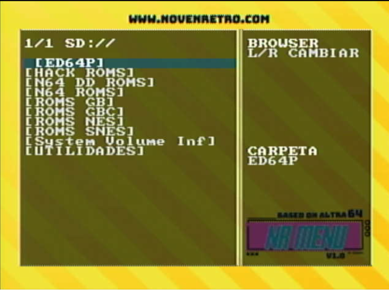
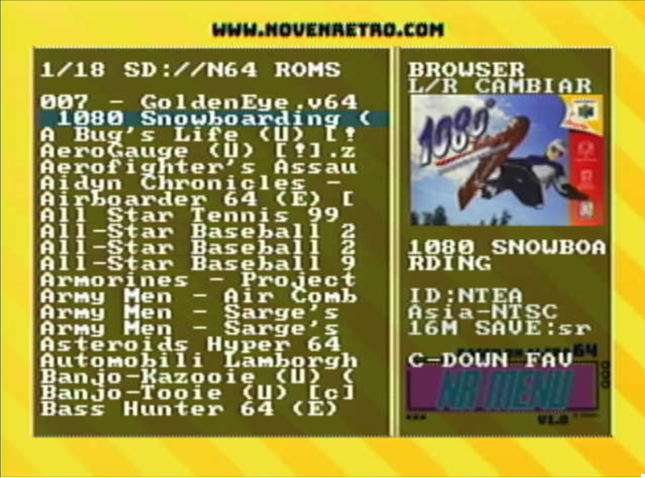
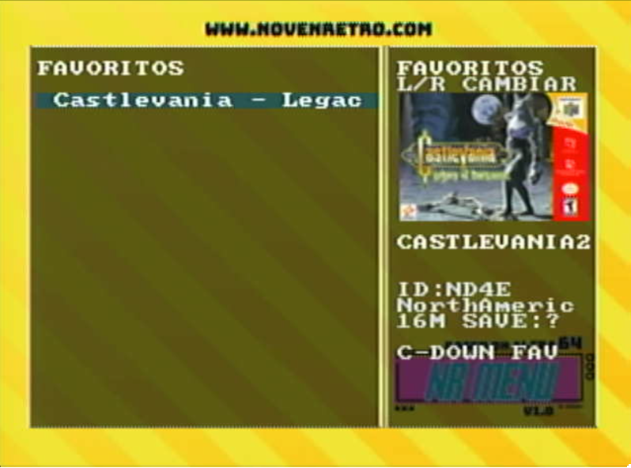
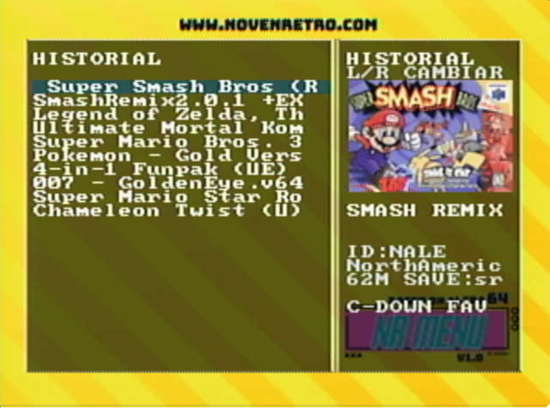

# NRMenu v1.0

[](https://github.com/NovenRetro/NRMenu/actions/workflows/build.yml)
[](https://github.com/NovenRetro/NRMenu/releases/latest)

NRMenu is a visual frontend for **ED64 Plus**, based on **ALTRA64**. It adds a two-panel browser, delayed box-art preview, persistent Favorites and History.

NRMenu is distributed free of charge. Official packages do not include ROMs. Use it at your own risk and always back up the SD card and save files.

## Status

**Stable firmware:** `NRMenu v1.0`  
**Repository/tooling revision:** `1.0.1`  
**Validated hardware:** ED64 Plus firmware v110  
**Pinned ALTRA64 base:** `666dee10724dd725183cf2183d67e7632c73b2de`

## Main features

- Two-panel ROM browser.
- Delayed box-art and ROM information preview.
- Browser, Favorites and History tabs with `L/R`.
- Up to 64 persistent favorites.
- History of the last 20 games.
- Correct parent-folder navigation with `B`.
- Opaque secondary windows for readability.
- Top 15 and file deletion disabled.

## Real hardware screenshots

<table>
  <tr>
    <td align="center" width="50%">
      <br>
      <strong>Main browser</strong>
    </td>
    <td align="center" width="50%">
      <br>
      <strong>ROM box art and information</strong>
    </td>
  </tr>
  <tr>
    <td align="center" width="50%">
      <br>
      <strong>Persistent Favorites</strong>
    </td>
    <td align="center" width="50%">
      <br>
      <strong>Game History</strong>
    </td>
  </tr>
</table>

## Installation

For a new SD card, download the **Ready to Use** package from the latest Release, extract it to the SD root and add your legally obtained ROMs. The package does not include ROMs.

To update an existing ALTRA64 or NRMenu setup, replace:

```text
ED64P\OS64P.v64
```

## Build

Requirements: Git, Docker Desktop, PowerShell and Python 3.

```bat
scripts\build.cmd
```

Output:

```text
dist\OS64P_NRMENU_v1.0.1.v64
```

The build uses the exact upstream commit and Docker image digest recorded in `build.env`.

## Install a local build

Pass the SD drive letter:

```bat
scripts\install-sd.cmd E
```

Running the command without an argument prompts for the drive letter.

For full documentation, see the Spanish [README](README.md) and the files under [docs](docs/).
